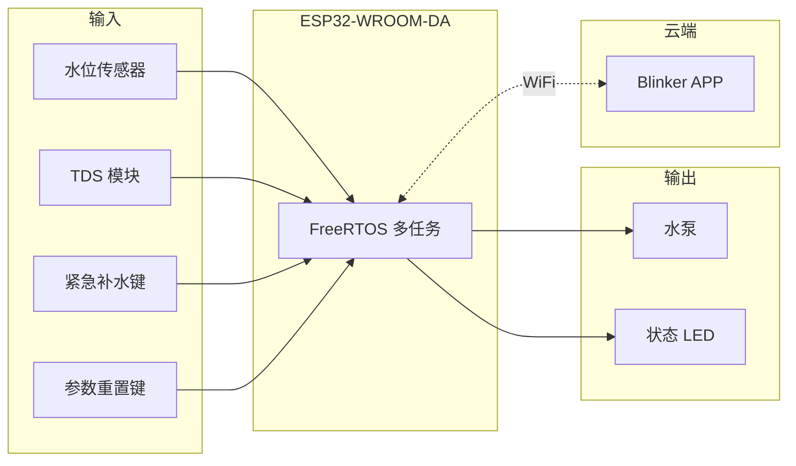
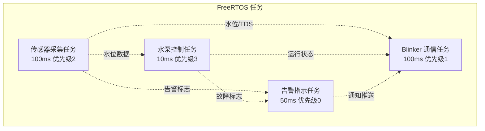
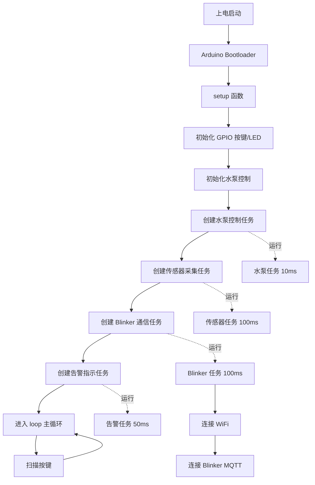
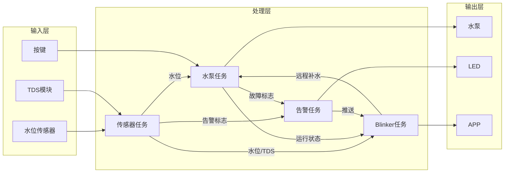
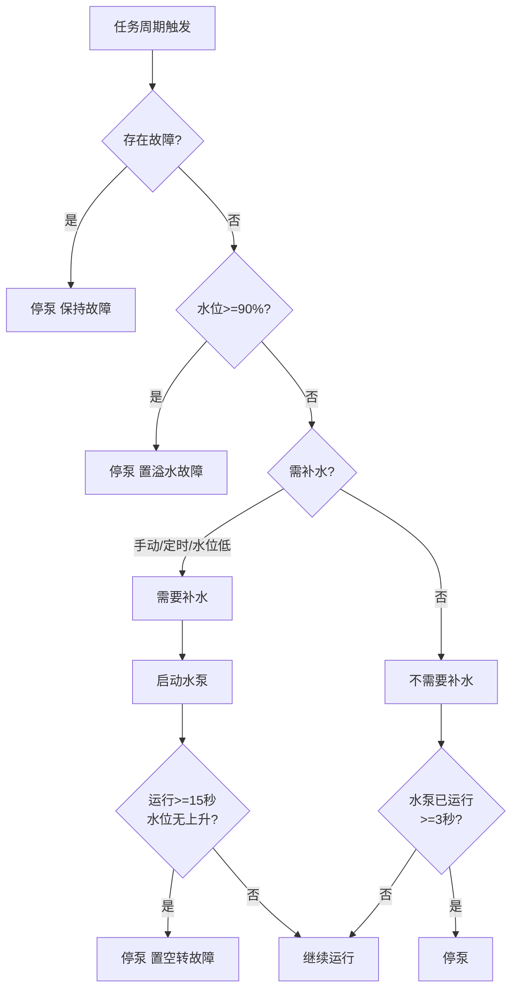

# 基于 FreeRTOS 的智能宠物饮水系统

《基于FreeRTOS的智能宠物饮水系统设计》配套软件工程，采用 Arduino IDE 开发，基于 ESP32-WROOM-DA 模块方案，结合点灯 Blinker 物联网平台实现远程监控与控制。

---

## 一、项目简介

### 1.1 课题背景

本系统面向家庭宠物饮水场景，以 **FreeRTOS 嵌入式实时操作系统** 为核心，通过多任务并行调度实现宠物饮水的自动化、智能化、远程化管理。课题旨在验证 FreeRTOS 在小型智能家居设备上的应用价值，完成从硬件选型、驱动开发、任务调度到云平台集成的全流程设计。

### 1.2 核心功能

| 功能类别   | 实现内容 | 说明 |
|------------|----------|------|
| 基础控制   | 自动补水、定时补水、手动紧急补水 | 水位低于 20% 自动启动水泵；支持 APP 定时与本地按键触发 |
| 水泵保护   | 空转保护、溢水保护 | 空转：运行 15 秒水位无上升则停机；溢水：水位达 90% 立即停泵 |
| 数据采集   | 水箱水位、TDS 水质 | 电阻式水位传感器 + TDS 模块，ADC 采集经滑动平均滤波 |
| 系统核心   | FreeRTOS 多任务调度 | 4 个任务并行运行，优先级 0~3，周期 10ms~500ms |
| 人机交互   | 本地按键 + APP 远程 | 2 个按键（紧急补水/参数重置）、1 个 LED；APP 监控、控制、告警 |
| 可靠性     | 双电源、异常告警 | 市电 + 18650 备用电池；缺水/溢水/TDS 超标推送到 APP |

### 1.3 技术栈

| 层级 | 组件 | 说明 |
|------|------|------|
| 硬件 | ESP32-WROOM-DA | Xtensa 双核 240MHz，WiFi+BLE，内置 FreeRTOS |
| 硬件 | 水位传感器、TDS 模块 | 模拟量输出，ADC 采集 |
| 软件 | Arduino IDE 2.x | 开发环境 |
| 软件 | arduino-esp32 | ESP32 开发板支持包 |
| 软件 | Blinker 库 | 点灯科技物联网 SDK |
| 云端 | Blinker 平台 | 设备管理、数据透传、APP 推送 |

---

## 二、系统架构

### 2.1 硬件框图



### 2.2 软件任务关系



### 2.3 系统启动流程

从设备上电到各任务稳定运行的完整流程如下：



### 2.4 数据流向

传感器、水泵、Blinker、告警之间的数据与事件流向：



### 2.5 补水控制决策流程

水泵启停的完整逻辑如下（由水泵控制任务每 10ms 执行一次）：



---

## 三、文件架构

### 3.1 目录结构

```
PetWaterSystem/
├── PetWaterSystem.ino    # 主程序：setup/loop、FreeRTOS 任务创建、按键扫描
├── config.h              # 引脚定义、阈值参数、WiFi 与 Blinker 配置
├── pump_control.h        # 水泵控制与保护逻辑声明
├── pump_control.cpp      # 水泵启停、空转/溢水保护实现
├── sensor_task.h         # 传感器采集任务声明
├── sensor_task.cpp       # 水位/TDS 采集、滑动平均滤波、告警检测
├── blinker_comm.h        # Blinker 通信声明
├── blinker_comm.cpp      # 数据上报、远程补水、告警推送
├── alarm_task.h          # 告警与状态指示声明
├── alarm_task.cpp        # LED 闪烁、异常告警逻辑
├── filters.h             # 滑动平均滤波器声明
├── filters.cpp           # 滤波器实现
└── README.md             # 本技术文档
```

### 3.2 模块职责

| 文件               | 职责 | 依赖关系 |
|--------------------|------|----------|
| `config.h`         | 集中管理引脚、阈值、任务参数、WiFi 与 Blinker 密钥 | 被各模块引用 |
| `pump_control.*`   | 水泵 GPIO 控制，自动/手动/定时补水，空转与溢水保护 | 依赖 config |
| `sensor_task.*`    | ADC 采集水位与 TDS，滤波，阈值判断，告警标志，调用 pump_setWaterLevel | 依赖 config、filters、pump_control |
| `blinker_comm.*`   | Blinker 初始化，数据上报，远程按钮回调，告警推送 | 依赖 config、sensor_task、pump_control |
| `alarm_task.*`     | LED 状态指示，异常快闪，协同 Blinker 告警通知 | 依赖 config、sensor_task、blinker_comm、pump_control |
| `filters.*`        | 滑动平均滤波，抑制传感器噪声 | 独立，无依赖 |

### 3.3 数据流向

传感器任务采集水位、TDS → 水泵任务根据水位决策启停；传感器任务、水泵任务 → Blinker 任务上报数据；传感器任务、水泵任务置位告警标志 → 告警任务更新 LED、推送通知。

---

## 四、硬件连接

### 4.1 引脚分配表

| 功能       | ESP32-WROOM-DA GPIO | 类型 | 连接说明 |
|------------|---------------------|------|----------|
| 水泵控制   | GPIO4               | 输出 | 经 S8050 三极管驱动，高电平启动水泵 |
| 水位传感器 | GPIO34              | 模拟输入 | ADC1_CH6，0~3.3V，仅输入 |
| TDS 传感器 | GPIO35              | 模拟输入 | ADC1_CH7，0~3.3V，仅输入 |
| 紧急补水键 | GPIO13              | 输入上拉 | 按下为 LOW，需 80ms 消抖 |
| 参数重置键 | GPIO14              | 输入上拉 | 按下为 LOW，清除故障标志 |
| 状态 LED   | GPIO2               | 输出 | 经 220Ω 限流，高电平亮（部分开发板有板载 LED） |

### 4.2 水泵驱动电路

```
GPIO4 ──[1kΩ]──┬── S8050 基极
               │
          S8050 发射极 ── GND
          S8050 集电极 ── 水泵正极
               
水泵: 正极 ← 集电极，负极 ← GND
1N4007: 与水泵反向并联（阴极接水泵正极，阳极接 GND）作续流保护
```

### 4.3 接线注意事项

- **ADC 限制**：WiFi 开启时仅 ADC1（GPIO32-39）可用，故水位/TDS 使用 GPIO34、35
- 水位、TDS 模拟输出范围需在 0~3.3V 内，超出需加分压电阻
- 按键使用内部上拉，无需外接上拉电阻
- 水泵工作电流约 200~500mA，S8050 最大 Ic 约 700mA，需确认水泵规格

---

## 五、开发环境与依赖

### 5.1 环境要求

- **Arduino IDE**：2.x
- **开发板**：ESP32 by Espressif Systems（含 ESP32 / ESP32-WROOM-DA 支持）
- **库**：Blinker（点灯科技）

### 5.2 安装步骤

1. 安装 Arduino IDE
2. 添加 ESP32 开发板：`文件 → 首选项 → 附加开发板管理器网址` 填入：
   ```
   https://raw.githubusercontent.com/espressif/arduino-esp32/gh-pages/package_esp32_index.json
   ```
3. `工具 → 开发板 → 开发板管理器`，搜索 `esp32`，安装 **esp32**
4. `工具 → 库管理器`，搜索 `Blinker`，安装 **Blinker**（点灯科技）
5. `工具 → 开发板` 选择 **ESP32 Dev Module** 或 **ESP32-WROOM-DA Module**

### 5.3 编译超限修复（Sketch too big / text section exceeds available space）

若出现程序存储空间超出（约 102%），请按以下步骤操作：

1. **修改分区方案**：`工具 → Partition Scheme（分区方案）` 选择：
   - **Minimal SPIFFS (1.9MB APP with OTA/190KB SPIFFS)** 或  
   - **Huge APP (3MB No OTA/1MB SPIFFS)**  
   可将应用分区从默认约 1.3MB 增至约 1.9MB 或 3MB。

2. **关闭调试输出**：在 `config.h` 中确保 `DEBUG_SERIAL` 已被注释（默认已关闭，可减少约 20KB）。

3. **编译优化**：`工具 → 优化` 选择 **-Os（最小体积）**（若菜单中有此选项）。

完成上述修改后，重新编译上传即可。

---

## 六、配置与烧录

### 6.1 修改 config.h

打开 `config.h`，**必改**以下三项：

```c
#define BLINKER_AUTH    "你的点灯设备密钥"
#define WIFI_SSID       "你的WiFi名称"
#define WIFI_PASSWORD   "你的WiFi密码"
```

**可选**修改阈值（默认值如下）：

| 宏名 | 默认值 | 说明 |
|------|--------|------|
| `WATER_LEVEL_LOW` | 20 | 低于此百分比自动补水 |
| `WATER_LEVEL_HIGH` | 90 | 达到此值停泵（溢水保护） |
| `WATER_LEVEL_CRITICAL` | 5 | 低于此值触发缺水告警 |
| `TDS_WARN` | 500 | 超过此 ppm 触发水质告警 |
| `PUMP_DRY_RUN_SEC` | 15 | 空转保护判定时间（秒） |

### 6.2 Blinker 设备配置

1. 下载「点灯」APP（应用商店搜索「Blinker」或「点灯」）
2. 注册并登录，点击「添加设备」→ 选择「独立设备」→ 接入方式选 **WiFi**
3. 记录设备 **Secret Key**（密钥），复制到 `BLINKER_AUTH`
4. 在设备编辑界面添加组件（键名必须与代码一致）：

   | 组件类型 | 键名 | 说明 |
   |----------|------|------|
   | 数据 | `num-level` | 显示水位百分比 |
   | 数据 | `num-tds` | 显示 TDS 值 ppm |
   | 按键 | `btn-pump` | 远程触发补水 |

### 6.3 烧录步骤

1. USB 连接 ESP32 开发板，**部分板型需按住 Boot 键再点击 Reset** 进入下载模式
2. `工具 → 端口` 选择对应 COM 口（如 COM3）
3. 点击 **上传** 按钮，等待编译与烧录完成

---

## 七、功能验证建议

### 7.1 测试项清单

| 测试项       | 操作                     | 预期现象 |
|--------------|--------------------------|----------|
| 自动补水     | 水位低于 20% 时          | 水泵自动启动，水位升高至 20% 以上后停止 |
| 手动补水     | 按下紧急补水键或 APP 按钮 | 水泵启动，补至 20% 以上后自动停止 |
| 溢水保护     | 水位达 90%               | 水泵立即停止，LED 快闪，APP 推送「溢水告警」 |
| 空转保护     | 水泵运行约 15 秒水位无变化 | 水泵停止，LED 快闪，APP 推送「水泵空转保护」 |
| 缺水告警     | 水位低于 5%              | LED 快闪，APP 推送「缺水告警」 |
| TDS 告警     | TDS 超过 500 ppm         | LED 快闪，APP 推送「水质告警」 |
| 参数重置     | 故障状态下按下参数重置键 | 清除故障标志，系统恢复正常 |

### 7.2 LED 状态说明

| 状态 | LED 表现 |
|------|----------|
| 正常 | 慢闪（约 0.8 秒亮、0.2 秒灭） |
| 异常 | 快闪（约 0.1 秒亮、0.2 秒灭） |

---

## 八、论文撰写要点

### 8.1 可引用图表

- **图 2.1 硬件框图**：系统输入输出与云平台关系
- **图 2.2 软件任务关系**：4 个 FreeRTOS 任务及数据流
- **图 2.3 系统启动流程**：从上电到多任务运行的完整流程
- **图 2.4 数据流向**：输入/处理/输出层数据流
- **图 2.5 补水控制决策流程**：水泵启停与保护逻辑
- **表 3.1 模块职责**：软件分层与依赖
- **表 4.1 引脚分配**：硬件接口定义

### 8.2 关键技术点

| 技术点 | 说明 | 对应代码/配置 |
|--------|------|---------------|
| FreeRTOS 多任务 | 4 任务并行，优先级 0~3，保证水泵控制实时性 | pump_task、sensor_task、blinker_task、alarm_task |
| 滑动平均滤波 | 窗口 8~12，抑制 ADC 噪声 | filters.cpp、FILTER_WINDOW_* |
| 水泵保护 | 空转 15 秒检测、溢水 90% 立即停泵 | pump_control.cpp |
| 物联网集成 | Blinker MQTT，数据上报与远程控制 | blinker_comm.cpp |

### 8.3 扩展方向

- 浊度传感器：扩展水质检测（开题可选）
- DHT11：环境温湿度监测
- HC-SR501：人体红外，宠物靠近自动供水

---

## 九、常见问题

| 现象 | 可能原因 | 处理 |
|------|----------|------|
| 编译超限 | 默认分区约 1.3MB 不足 | 修改分区方案为 Minimal SPIFFS 或 Huge APP |
| 连接不上 WiFi | SSID/密码错误、2.4G 兼容 | 确认 WiFi 为 2.4G，密钥正确 |
| APP 无数据 | 设备未上线、键名不一致 | 检查 Blinker 密钥、APP 组件键名与代码一致 |
| 水位/TDS 异常 | 传感器接线、ADC 引脚冲突 | 确认 GPIO34/35 接线正确，TDS 系数可调 |

---

## 十、许可证与声明

本项目为本科毕业设计《基于 FreeRTOS 的智能宠物饮水系统设计》配套代码，仅供学习与毕设使用。硬件接线与参数需根据实际元件调整，TDS 标定系数需根据传感器手册或实测校准。
